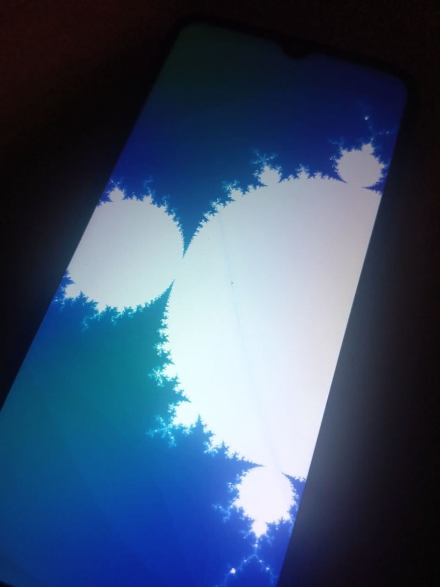

# GPU

[Noctyde](https://github.com/Noctyde) got hardware GPU acceleration working inside a chroot. It uses Android's linker together with **72 vendor libraries** extracted from the `super.img` of **MIUI V12.5.3.0.RCSRUXM**:

```
pvr 1.13.5776728, BVNC 22.87.104.18, /dev/dri/card0 and renderD128
/proc/pvr/status: Driver Status: OK, Firmware Status: OK
```

```
EGL 1.4: Imagination Technologies, 1.4 build 1.13@5776728, API OpenGL_ES
context: Imagination Technologies / PowerVR Rogue GE8320 / OpenGL ES 3.2 build 1.13@5776728
shader draw: pixels match
```



## Performance

- **Offscreen:** a fractal shader renders at **878 FPS** at 360×800 (about 250 Mpixel/s).
- **On screen:** a demo that copies rendered frames to `/dev/fb0` runs at **20 FPS**. The bottleneck is the CPU copy, not the GPU.


Please see [Noctyde's gist](https://gist.github.com/Noctyde/bd991ef60538bf37115d0f6befb615ae) and [Issue #5](https://github.com/99-blossom/alpican/issues/5) for more info (there are also guides there if you want to try it yourself). Note that Alpican **does not** use this kernel and **does not** include any GPU fixes yet, at least for now.

> [!IMPORTANT]
> This is *not* desktop acceleration yet: **Xorg** and **Wayland compositors** cannot use this user space directly, that would need something like `libhybris`.