## Screen photos

  <a href="../assets/3.jpg">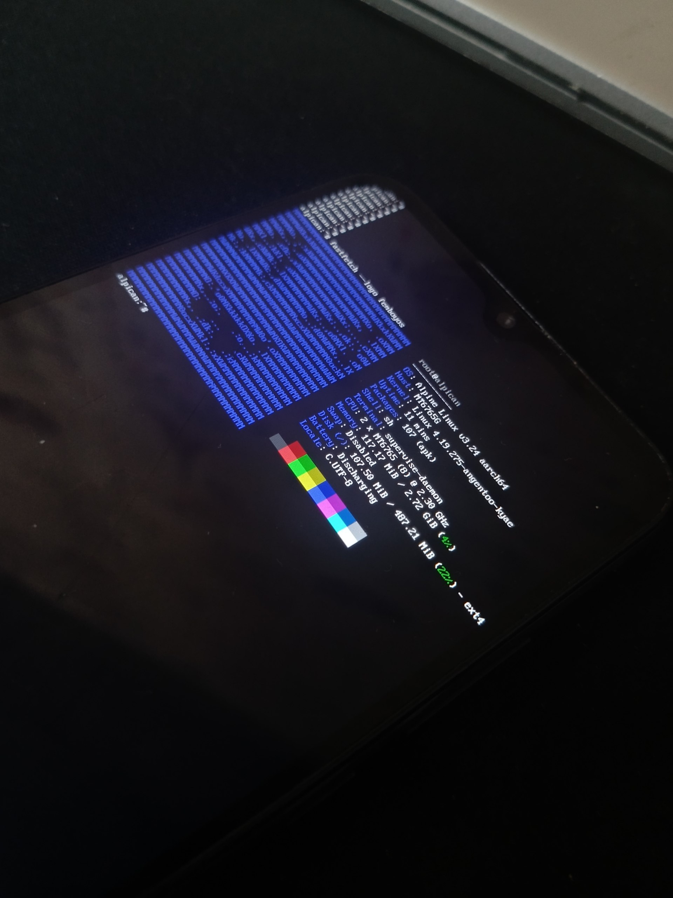</a>
  <a href="../assets/2.jpg">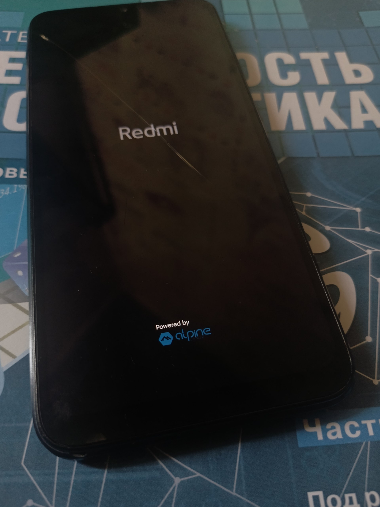</a>
  <a href="../assets/redmi_9a.jpg">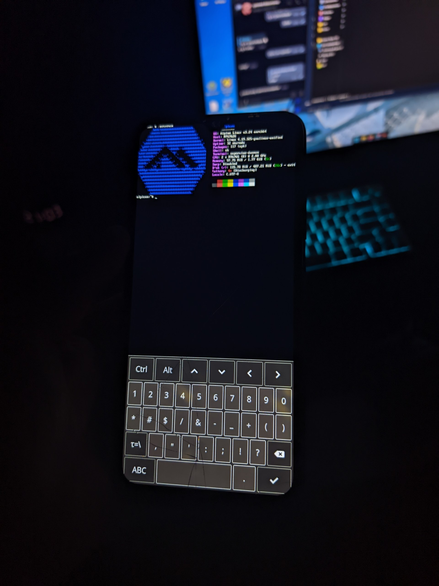</a>
  <a href="../assets/7lxqt.jpg">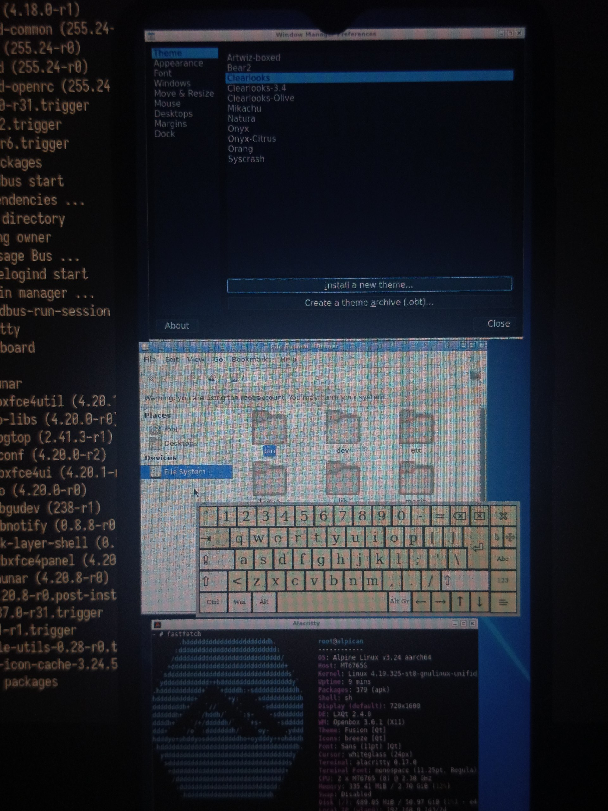</a>
  <a href="../assets/weston.jpg">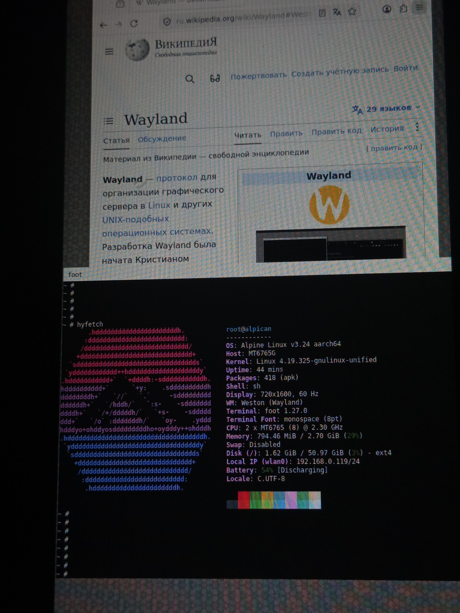</a>
  <a href="../assets/6.jpg">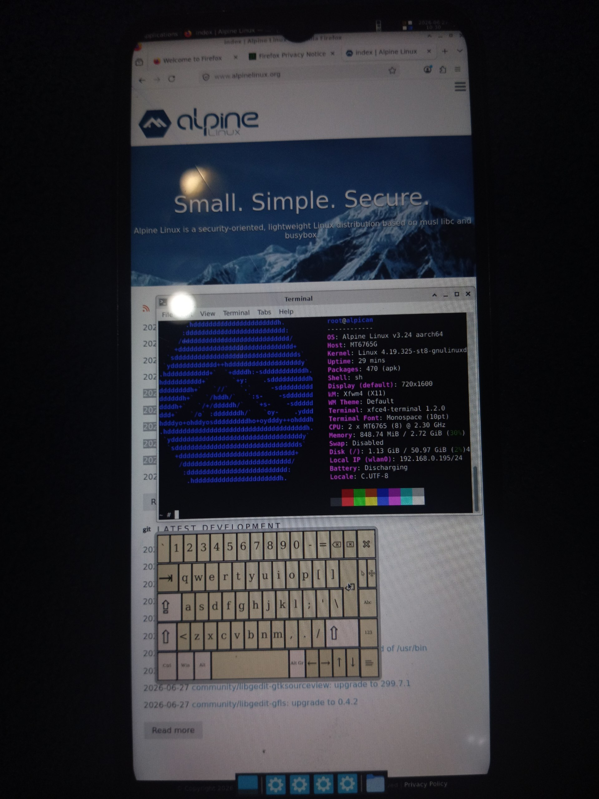</a>
  <a href="../assets/5.jpg">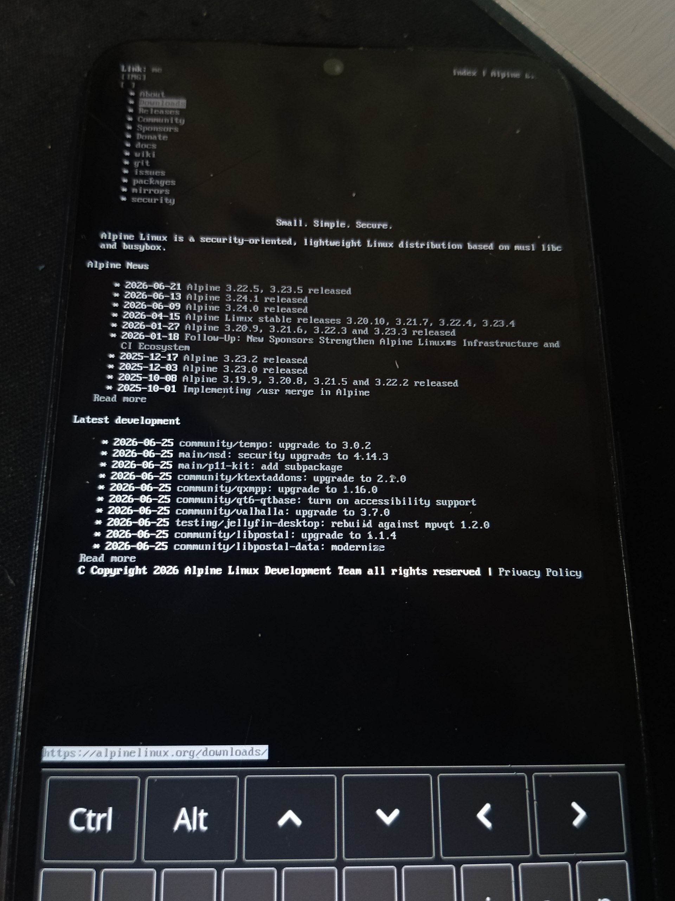</a>
  <a href="../assets/4.jpg">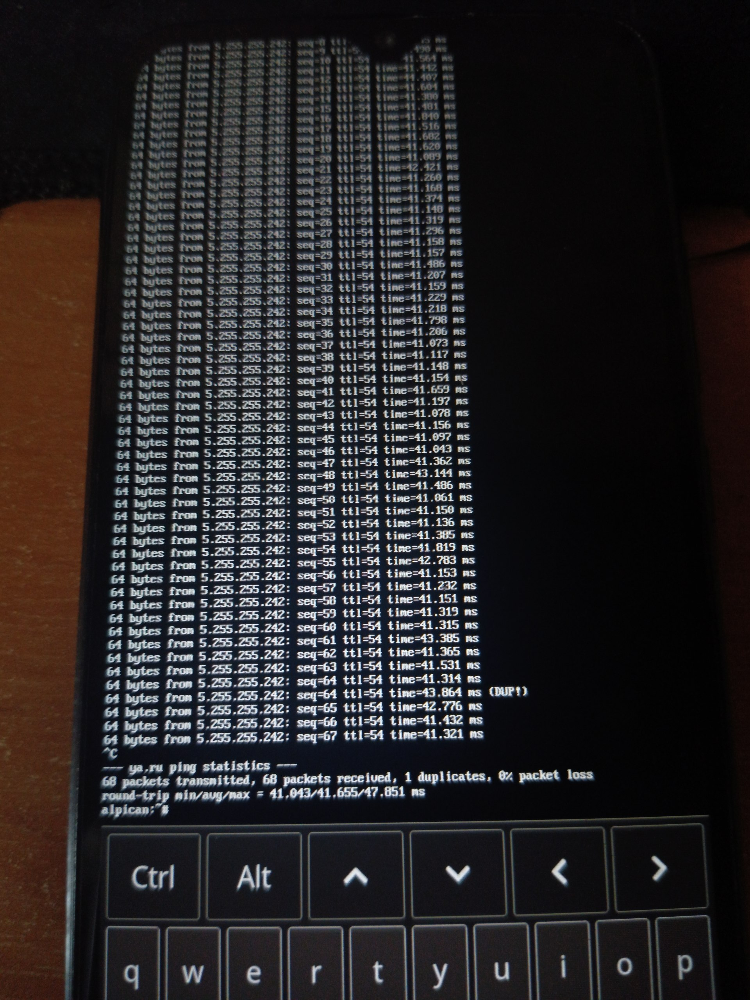</a>
  <a href="../assets/gpu-demo.png">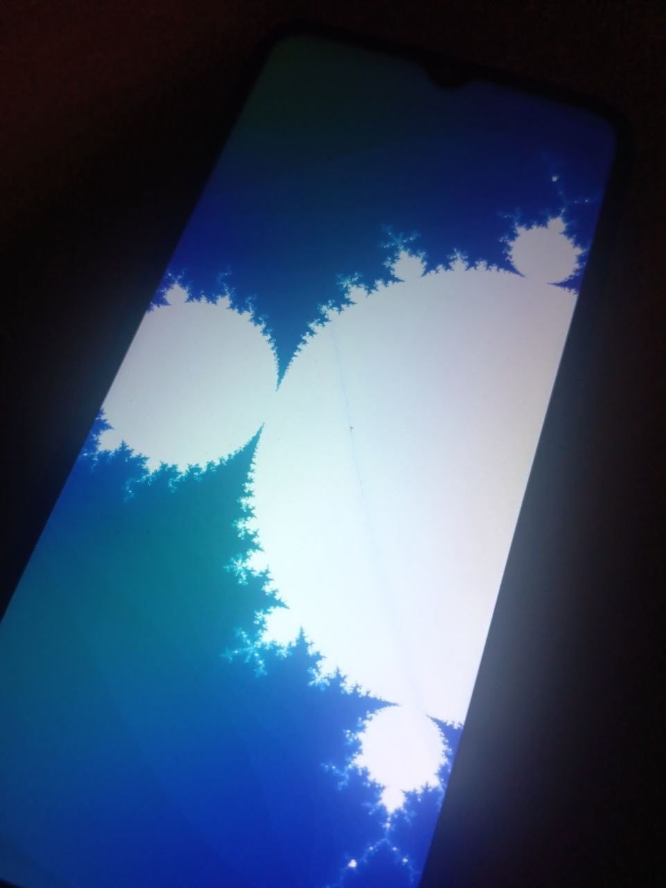</a>

## Screenshots

  <a href="../assets/xfce4-scrot.png">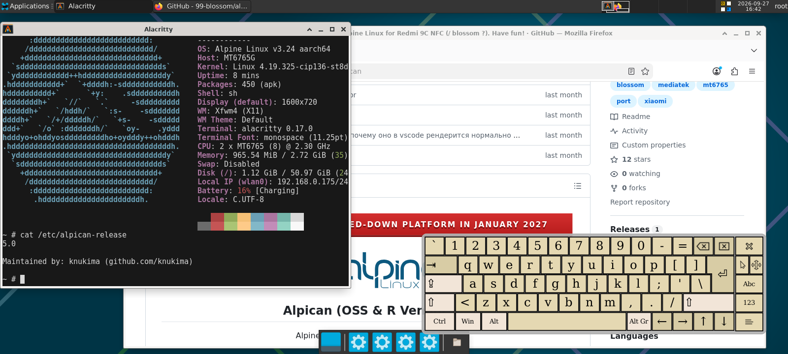</a>
  <a href="../assets/ssh.png">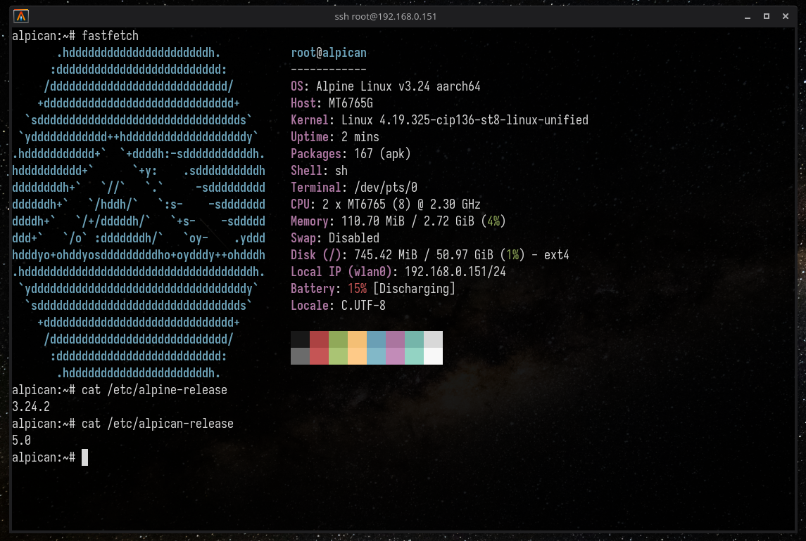</a>
  <a href="../assets/vnc_openbox.png">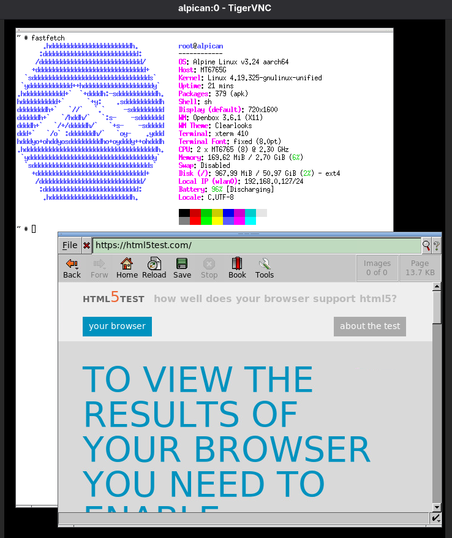</a>

