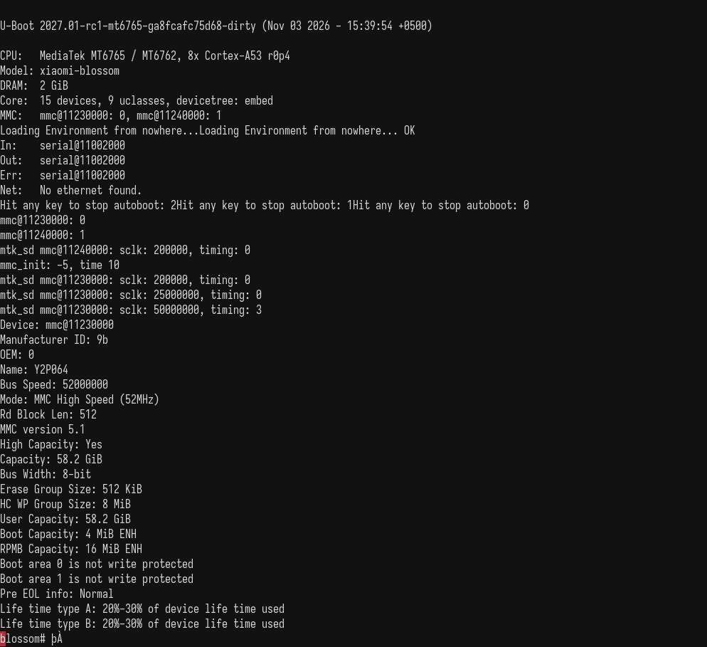
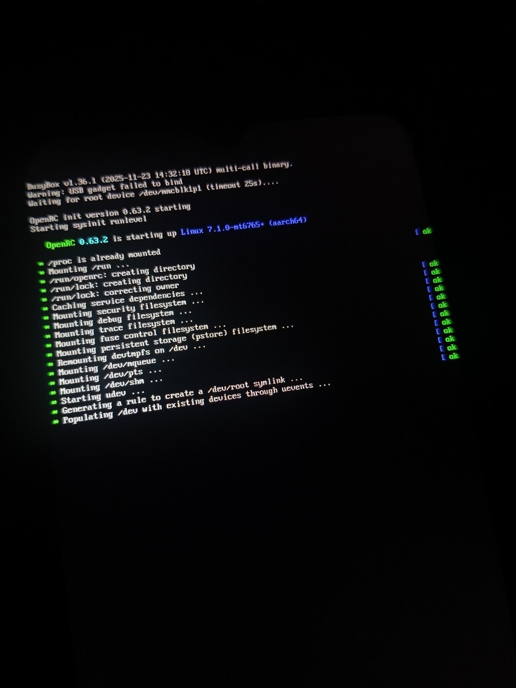
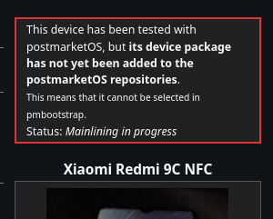

## Mainline / U-Boot
[← Back to README](../README.md)

### U-Boot
Previously, U-Boot was chain-loaded by LK. Now it boots **instead of** LK, using [this fork](https://github.com/knukima/u-boot-mt6765):

 
However, I have no plans to replace LK with U-Boot at the moment.

### Mainline Kernel
Alpican can boot into Alpine userspace from an SD card on mainline kernel 7.1.0 using [uniLoader](https://github.com/ivoszbg/uniLoader), which officially supports `xiaomi-blossom` :

### pmOS moment

