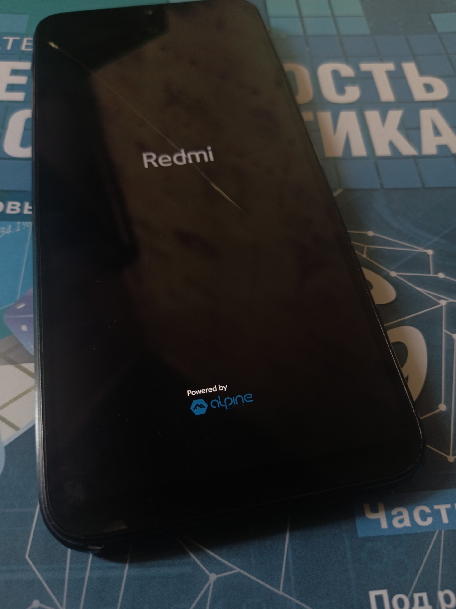
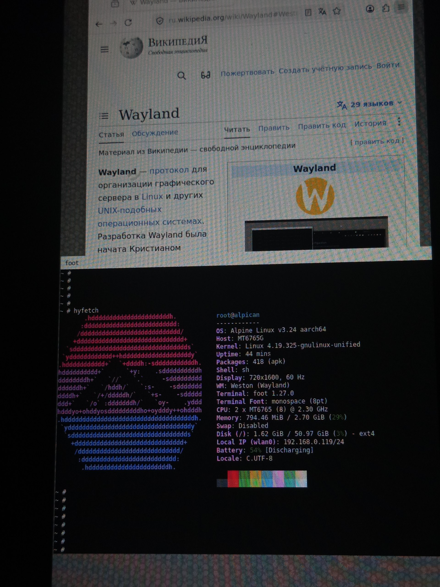
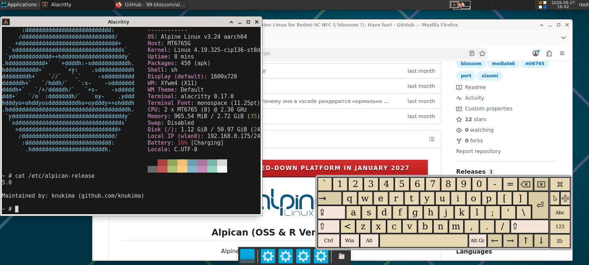

<a href="https://keepandroidopen.org">
  
</a>
<br>
<br>

<p align="center">
  
</p>
<h2 align="center">Alpican – R / OSS Vendor</h2>
<p align="center">Alpine Linux for <code>xiaomi-blossom</code></p>

> [!WARNING]  
> **You** are solely responsible for **any** damage, data loss, bricking, or loss of warranty to your device. 
>
> Proceed **only** if you fully understand what you are doing and accept all associated risks. If not, please leave this page!

## Changelog
* **Alpican version:** v5.0 (based on Alpine v3.24.3, aarch64);
* [🇬🇧 Changelog EN](Docs/changelog/en.md)
* [🇷🇺 Changelog RU](Docs/changelog/ru.md)

## Images
<p align="left">
  
  
  
</p>

<p align="left">
  
</p>

---

📸 [all screenshots](Docs/IMAGES.md)


## Why
This project **aims** to bring a minimal, fast, and highly customizable `Alpine Linux` environment to `xiaomi-blossom` (**MT6762** / **MT6765**) devices. The **goal** is to move beyond heavily modified Android userlands and explore a clean, _Unix-like_ system on mobile hardware.

Alpine was chosen because of its simplicity, small footprint, and flexibility. It provides a lightweight base system that can be easily adapted for embedded devices and experimental ports. Unlike traditional Android-based distributions, Alpine gives **full** control over the system without unnecessary services or background overhead.

If you find any bugs, please [open an issue](https://github.com/99-blossom/alpican/issues) or reach out in any way you can. I _may_ be slow to respond, as I work on projects in my free time.

After boot into a shell, the system typically consumes **only ~80MB of RAM**:
<details>

<summary><code>free -h</code></summary>
<br>

```
alpican:~# free -h
              total        used        free      shared  buff/cache   available
Mem:           2.7G       78.2M        2.6G      588.0K       41.0M        2.6G
Swap:             0           0           0
alpican:~#
```

</details>

## Guides

* [🇬🇧 Install EN (fastboot)](Docs/install/en.md)
* [🇷🇺 Install RU (fastboot)](Docs/install/ru.md)

## Status
> [!IMPORTANT]
> Features not listed here have not been tested or confirmed to work. Statuses marked as **Untested** or **Broken** are not functional or verified yet.

<details>

<summary><b>Feature status table</b></summary>
<br>

| Feature | Status | Notes |
| :--- | :---: | :--- |
| **Flashing** |  |  |
| **Booting** |  | `OpenRC`, `systemd`, `runit` (all work, but **OpenRC** is used) |
| **Storage** |  | Internal (**eMMC**), external (**MicroSD** cards) |
| **Display** |  | Framebuffer (`mtkfb`, `/dev/fb0`), console output, brightness control |
| **Console** |  | `agetty`, `tty`, cursor visibility |
| **Wi-Fi** |  | `wpa_supplicant`, `dhcpcd` (**wlan0**, **ap0**, **p2p0**) |
| **Bluetooth** |  | |
| **NFC** |  | `/dev/sec-nfc` exists |
| **GPS** |  | |
| **Battery** |  | Charging status and percentage tracking |
| **SSH** |  | `openssh` |
| **Pkg manager**|  | `apk` |
| **USB Gadget** |  | Serial console (`/dev/ttyGS0` via ACM) |
| **Inputs** |  | Touchscreen (`buffyboard`), **OTG** keyboard |
| **Audio** |  | `aplay` tested, `alsamixer` config required |
| **Virtualization** |  | `qemu-system-aarch64`, `qemu-system-x86_64` (`/dev/kvm` exists) |
| **X11** |  | `X.Org`, `xorg-server`, `xf86-video-fbdev`, `x11vnc` (basically any X11 WM/DE) |
| **Wayland** |  | `fbdev-backend`, Weston (10.0.5, `fbdev-backend.so`, **!> 11**) |
| **Misc**|  | Flashlight, Vibration motor |
| **Camera** |  ||
| **Calls** |  | |
| **Cellular Data** |  | ccci/smem init fail|
| **SMS** |  |  |
| **Fingerprint** |  | |
| **Sensors** |  | `m_*_misc` sensors |
| **GPU**|  |  See [Docs/GPU.md](Docs/GPU.md) |

</details>


## Acknowledgments

* See [Docs/ACKNOWLEDGMENTS.md](Docs/ACKNOWLEDGMENTS.md)

## Star History

<a href="https://www.star-history.com/?repos=99-blossom%2Falpican&type=date&legend=top-left">
 <picture>
   <source media="(prefers-color-scheme: dark)" srcset="https://api.star-history.com/chart?repos=99-blossom/alpican&type=date&theme=dark&legend=top-left" />
   <source media="(prefers-color-scheme: light)" srcset="https://api.star-history.com/chart?repos=99-blossom/alpican&type=date&legend=top-left" />
   
 </picture>
</a>

## Liked it?
* **KISS**
* ... and if you find this project useful or interesting, please consider leaving a ⭐ **star**!